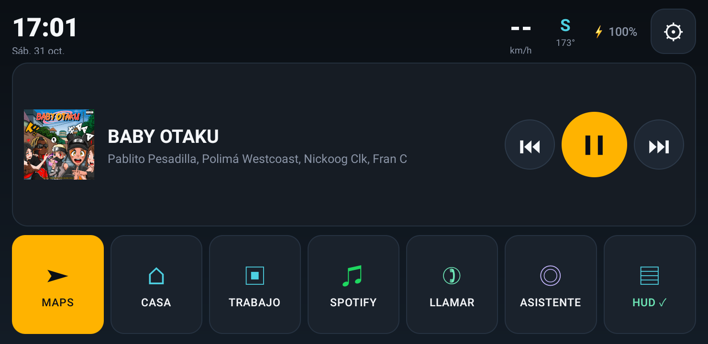
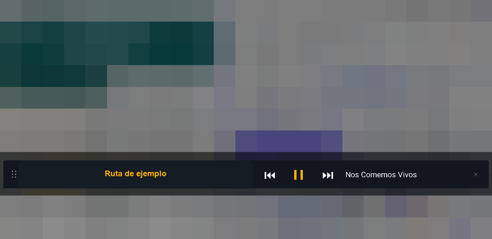
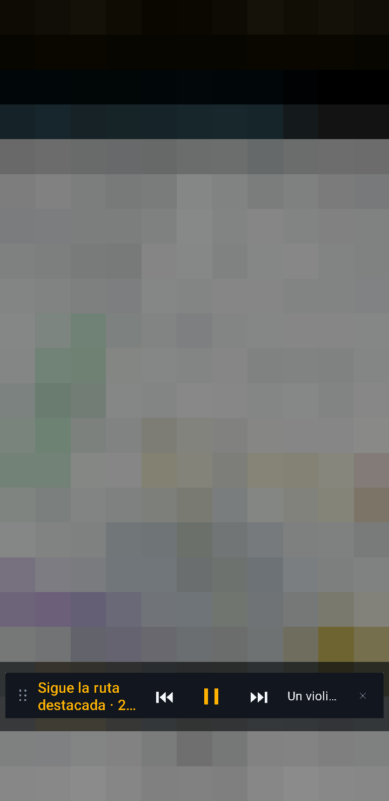
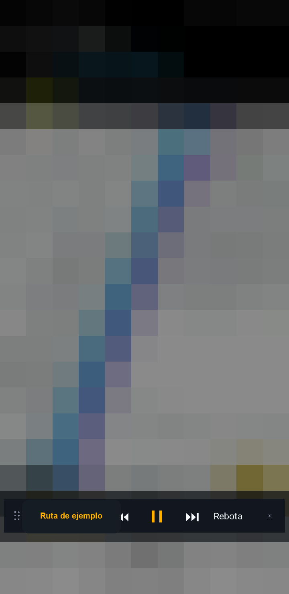
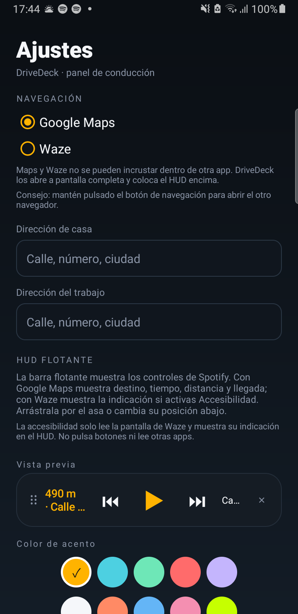
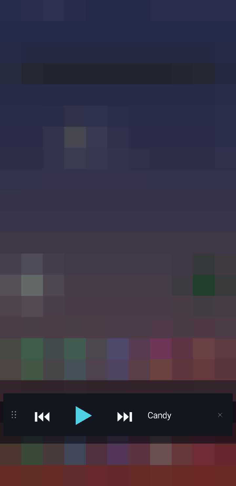

# DriveDeck

Panel de conducción para Android. Pensado para llevar el móvil en horizontal en el coche:
Maps o Waze a pantalla completa y una barra flotante con Spotify y la información de ruta.







HUD sobre Waze: con el servicio de accesibilidad activo muestra la indicación y el
tiempo/distancia; los controles de Spotify siguen disponibles.



Prueba con GPS simulado: la indicación del HUD cambió mientras Waze navegaba.

## Qué hace

- Reloj, fecha, velocidad GPS, brújula y batería.
- Controla Spotify (o cualquier reproductor activo): anterior, play/pausa, siguiente, carátula y título.
- Lanza Google Maps o Waze con un toque.
- Atajos directos a Casa y Trabajo: se configuran en Ajustes → **Destinos** y abren la
  ruta directamente en el navegador elegido (o el otro si el primero falla).
- HUD flotante sobre Maps/Waze con los controles de música; con Google Maps muestra
  destino, tiempo, distancia y llegada, y con Waze la indicación y la ruta si activas
  Accesibilidad. Se arrastra por el asa `⠿`, se cierra con `✕` y recuerda la posición.
  En horizontal es una barra compacta que se puede mover por toda la pantalla.
- HUD personalizable: 10 colores de acento, 5 fondos, opacidad, tamaño, posición y
  elementos visibles, con vista previa y restablecer.
- El acento elegido también cambia el botón de navegación y el de música del salpicadero.
- **LLAMAR** deja elegir entre Contactos y WhatsApp; **ASISTENTE** abre el asistente de voz.
- Pantalla siempre encendida, modo inmersivo y tema oscuro.
- No pide internet, ni cuenta, ni anuncios, ni analítica.

## Lo que no puede hacer (y por qué)

Google Maps y Waze no permiten incrustar su navegación dentro de otra app. DriveDeck los abre
a pantalla completa y dibuja el HUD encima. La indicación de giro grande sigue siendo la de
Maps/Waze. Con Google Maps, el HUD muestra lo que publica su notificación de navegación
(destino, tiempo, distancia y llegada). Con Waze, esta versión solo publica «En marcha. Toca
para abrir.» sin datos de ruta; por eso DriveDeck lee la indicación de la propia pantalla de
Waze mediante un servicio de accesibilidad opcional (ver abajo). Sin accesibilidad, el HUD
con Waze aporta solo los controles de Spotify. Así se usan los dos a la vez sin cambiar de app.

## Instalar

El APK está en `DriveDeck.apk`. Con el móvil conectado por USB y depuración USB activada:

```bash
adb install -r DriveDeck.apk
```

## Primer uso

1. Abre DriveDeck.
2. Ajustes (`⚙`) y concede:
   - **Acceso a notificaciones**: necesario para controlar Spotify y leer la info de ruta.
   - **Mostrar sobre otras apps**: necesario para el HUD.
   - **Ubicación**: velocidad y brújula.
   - **Accesibilidad (Waze)**: solo si usas Waze, para leer su indicación en el HUD.
3. Elige Google Maps o Waze y guarda casa y trabajo en **Ajustes → Destinos**.
4. En el salpicadero:
   - Toca **MAPS/WAZE** para abrir la navegación. Mantén pulsado para abrir el otro.
   - Toca **HUD** para activar la barra flotante.
   - **CASA/TRABAJO** abren la ruta directamente en el navegador elegido. Mantén pulsado
     para ir a Destinos y editar la dirección.
   - **SPOTIFY** abre Spotify; mantén pulsado para play/pausa.
   - **LLAMAR** pregunta si abrir Contactos o WhatsApp; **ASISTENTE** abre el asistente de voz.
5. El HUD se oculta mientras estás en las pantallas de DriveDeck y aparece al salir a Maps,
   Waze o cualquier otra app. Su posición se guarda.
6. Para cambiar colores, tamaño, posición o elementos del HUD: Ajustes → **HUD FLOTANTE**.

## Accesibilidad para Waze

Waze no incluye la indicación de giro en su notificación, así que DriveDeck la lee de su
pantalla con un servicio de accesibilidad. Es opcional y solo afecta a Waze:

1. Ajustes (`⚙`) → **Accesibilidad (Waze)** → **ABRIR**.
2. Activa **DriveDeck · lectura de Waze**.
3. Vuelve a DriveDeck. El HUD mostrará la indicación, el tiempo y la distancia de Waze.

El servicio está limitado al paquete `com.waze`, solo lee texto de la pantalla y nunca pulsa
botones, no lee otras apps ni envía nada. Cuando Waze deja de navegar, la indicación del HUD
se borra. Waze debe estar en primer plano para actualizar la indicación; si pasa más de 90 s
sin actualizaciones, el HUD deja de mostrarla para no enseñar un giro antiguo.

## Personalización del HUD

En Ajustes → **HUD FLOTANTE** hay una vista previa y estos controles:

- **Color de acento:** 10 colores. Cambia la indicación del HUD, el play y también el botón
  de navegación y el de música del panel principal.
- **Fondo:** negro, carbón, azul noche, morado noche o verde noche.
- **Tamaño:** pequeño, mediano o grande; afecta a botones y texto.
- **Opacidad:** del 40 al 100 %.
- **Posición:** abajo, centro o arriba. En horizontal el HUD es compacto y se puede
  arrastrar por toda la pantalla.
- **Elementos visibles:** indicación de ruta, título de la canción, asa y botón de cerrar.
- **Restablecer HUD:** vuelve a los valores por defecto.

Los cambios se aplican al instante reiniciando el HUD en segundo plano. Si ocultas el asa,
usa los botones de posición; si ocultas la ✕, cierra el HUD desde su notificación o con la
baldosa HUD del salpicadero.





## Compilar

Requiere JDK 21 y Android SDK con `platforms;android-34` y `build-tools;37.0.0`.
El script busca el SDK en `$HOME/.local/android-sdk`. No usa Gradle ni dependencias externas.

```bash
bash build.sh
```

El APK final se escribe en la raíz del proyecto. El `debug.keystore` permite actualizar la app
sin desinstalarla; consérvalo si quieres mantener la misma firma.

## Retomar el proyecto

### Misma conversación de Claude Code

Esta sesión se inició en `C:\Users\rober\.local\bin`. Para recuperarla, abre una terminal
en esa carpeta y ejecuta:

```powershell
cd C:\Users\rober\.local\bin
claude --continue
```

`claude --continue` retoma la última conversación de esa carpeta; `claude --resume` permite
elegir entre las sesiones. El historial de Claude Code está asociado a la carpeta de trabajo;
en la app de escritorio, abre la sesión desde el historial. Para guardar el texto de la
conversación, usa `/export` dentro de Claude Code.

### Sesión nueva con el proyecto

```powershell
cd C:\Users\rober\DriveDeck
claude
```

Y pide: «Continúa DriveDeck. Lee README.md, git log y gh release view v1.0.1.»

### Contexto que no está en el código

- Repo privado: https://github.com/RobertMaxCode/DriveDeck
- Release privada: https://github.com/RobertMaxCode/DriveDeck/releases/tag/v1.0.1
- `gh` está instalado en `C:\Users\rober\.local\bin\gh.exe` y autenticado en el llavero de
  Windows. No hay que pegar tokens.
- Compilar e instalar: ver **Compilar** e **Instalar** arriba.
- `debug.keystore` es local y no está en el repo ni en la release; no lo subas.
- Las capturas del repo están redactadas para no mostrar la ubicación.
- El móvil de pruebas es un Galaxy Note 9 (Android 10); adb está en
  `C:\Users\rober\.local\bin\platform-tools\adb.exe`.

## Probado en

Samsung Galaxy Note 9 (SM-N960F), Android 10 (API 29), con Google Maps, Waze y Spotify.

- Spotify: detección de la sesión, carátula y pausa/reanudación desde el HUD verificadas.
- Google Maps: navegación real y datos de ruta en el HUD verificados.
- Waze: ruta real iniciada y navegación verificada (23 min, 22 km). Con el servicio de
  accesibilidad activo, el HUD mostró «Sigue la ruta destacada · 23 min · 22 km · Llegada…»
  y se limpió al detener Waze. Waze no publica esos datos en su notificación; se leen de su
  pantalla. Sin accesibilidad, el HUD con Waze muestra solo los controles de Spotify.
  Maps sí comparte los datos de ruta por notificación.
- GPS simulado: con una app de prueba temporal se inyectó una ruta con giros y Waze navegó
  con esa posición. El HUD actualizó la indicación en tiempo real al cambiar de tramo.
  La app de prueba se desinstaló y se restauró el proveedor GPS real.

## Seguridad al conducir

Configura direcciones y permisos antes de arrancar. Durante la conducción usa los botones
grandes o el asistente de voz; no manipules el móvil. El teléfono debe ir montado y en horizontal.
